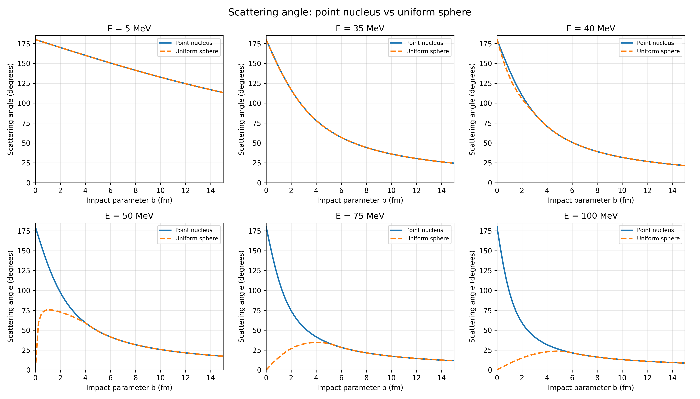
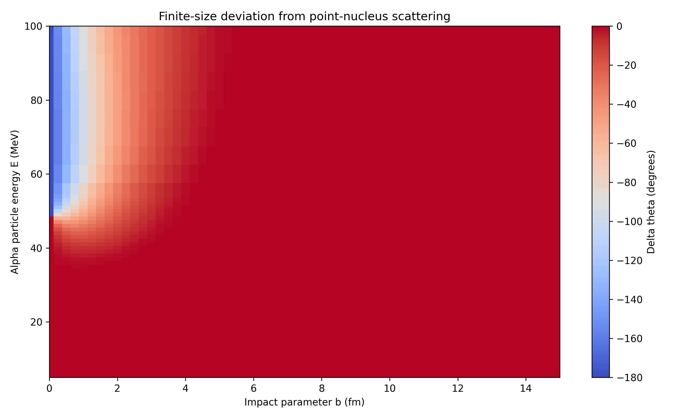
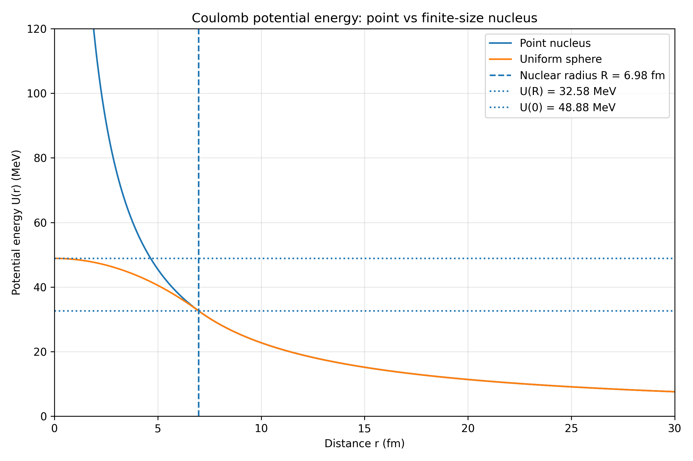

# Finite-size effects in Rutherford scattering

In the previous stages, Rutherford scattering was modeled using a point-like gold nucleus. The alpha particle moved in a repulsive Coulomb field, and its trajectory was calculated numerically using RK4.

The numerical scattering angles were also compared with the analytical Rutherford formula, and the numerical behavior of the simulation was investigated.

Until this stage, the nuclear charge was assumed to be concentrated at a single point.

In this stage, the model was extended to investigate what changes when the gold nucleus has a finite radius and its electric charge is distributed throughout a volume.


## 1. Why consider the finite size of the nucleus?

In the original Rutherford model, the potential energy of an alpha particle near a gold nucleus is

$$
U(r)=\frac{K}{r},
$$

where

$$
K=\frac{Z_\alpha Z_{\mathrm{Au}}e^2}{4\pi\varepsilon_0}.
$$

For an alpha particle and gold nucleus,

$$
Z_\alpha=2,\qquad Z_{\mathrm{Au}}=79.
$$

Using

$$
\frac{e^2}{4\pi\varepsilon_0}
=1.439964\ \mathrm{MeV\,fm},
$$

the interaction coefficient is

$$
K=227.514312\ \mathrm{MeV\,fm}.
$$

The point-nucleus potential energy increases without bound as the particle approaches the origin:

$$
\lim_{r\to0}U(r)=+\infty.
$$

The corresponding repulsive force is

$$
F(r)=\frac{K}{r^2}.
$$

Therefore, the closer the alpha particle gets to the nucleus, the stronger the repulsion becomes.

However, a real nucleus is not a point charge. Its positive charge is distributed over a finite region of space.

This raises a physical question:

**What happens to the scattering trajectory if the alpha particle gets close enough to probe the nuclear charge distribution itself?**

At large distances, the original Coulomb model is expected to remain valid. But at sufficiently small distances, the electric field may no longer behave as $1/r^2$.

To investigate this, a second model was introduced.

## 2. Two nuclear charge models

Two models were compared:

**Point nucleus**

All nuclear charge is concentrated at the origin.

**Uniformly charged sphere**

The same total nuclear charge is distributed uniformly throughout a sphere of radius $R$.

The total charge is identical in both cases. The only difference is its spatial distribution.

### Nuclear radius

The nuclear radius was estimated using

$$
R=r_0A^{1/3},
$$

where $A$ is the nuclear mass number and

$$
r_0=1.2\ \mathrm{fm}.
$$

For gold-197,

$$
A=197,
$$

so

$$
R=1.2\cdot197^{1/3}
\approx6.98\ \mathrm{fm}.
$$

This is an approximate nuclear-radius model, not a detailed experimental charge-density fit.

The characteristic distance separates two regions:

- Outside the nucleus: $r\ge R$.
- Inside the nucleus: $r<R$.

The central question is how the electrostatic force changes between these regions.

## 3. Why are the two models identical outside the nucleus?

The answer follows from Gauss's law.

For a spherically symmetric charge distribution,

$$
\oint\mathbf E\cdot d\mathbf S
=\frac{Q_{\mathrm{enc}}}{\varepsilon_0}.
$$

Outside the nucleus, a spherical Gaussian surface encloses the entire nuclear charge.

Therefore,

$$
E(r)=\frac{Z_{\mathrm{Au}}e}{4\pi\varepsilon_0r^2}.
$$

This is exactly the same electric field as that produced by a point charge of the same total magnitude.

Consequently, the force acting on the alpha particle is

$$
F(r)=\frac{K}{r^2},
\qquad r\ge R.
$$

And the potential energy is

$$
U(r)=\frac{K}{r},
\qquad r\ge R.
$$


**If an alpha particle never enters the nuclear radius, the two models predict exactly the same classical trajectory for identical initial conditions.**

The finite-size effect can appear only when the trajectory reaches the region where the charge distributions produce different electric fields.


## 4. What happens inside a uniformly charged sphere?

For a uniformly charged sphere, the volume charge density is constant.


$$
\rho=\frac{Q}{V}.
$$

The total charge of the gold nucleus is

$$
Q=Z_{\mathrm{Au}}e.
$$

The volume of a sphere of radius $R$ is

$$
V=\frac{4}{3}\pi R^3.
$$

Thus

$$
\rho=\frac{3Z_{\mathrm{Au}}e}{4\pi R^3}.
$$

Consider a spherical Gaussian surface with radius $r<R$.


Only part of the total nuclear charge is enclosed.


Because the charge density is uniform, the charge enclosed by a Gaussian surface of radius $r<R$ can be calculated as

$$
Q_{\mathrm{enc}}(r)=\rho V_{\mathrm{enc}}.
$$

The volume enclosed by this surface is

$$
V_{\mathrm{enc}}=\frac{4}{3}\pi r^3.
$$

Thus,

$$
Q_{\mathrm{enc}}(r)
=\frac{3Z_{\mathrm{Au}}e}{4\pi R^3}
\cdot\frac{4}{3}\pi r^3,
$$


$$
Q_{\mathrm{enc}}(r)
=Z_{\mathrm{Au}}e\frac{r^3}{R^3}.
$$


According to Gauss's law,

$$
\oint\mathbf E\cdot d\mathbf S
=\frac{Q_{\mathrm{enc}}(r)}{\varepsilon_0}.
$$

Due to spherical symmetry, the electric field is radial and has the same magnitude at every point on the Gaussian surface.

Therefore,

$$
\oint\mathbf E\cdot d\mathbf S
=E(r)\cdot4\pi r^2.
$$

Substituting the enclosed charge into Gauss's law gives

$$
E(r)\cdot4\pi r^2
=\frac{Z_{\mathrm{Au}}e}{\varepsilon_0}
\frac{r^3}{R^3},
$$


$$
E(r)=
\frac{Z_{\mathrm{Au}}e}{4\pi\varepsilon_0}
\frac{r}{R^3}.
$$


Multiplying by the alpha-particle charge gives the repulsive force inside the nucleus:

$$
F(r)=\frac{Kr}{R^3},
\qquad r \lt R.
$$

This is fundamentally different from the point-charge expression.

For a point nucleus,

$$
F_{\mathrm{point}}(r)=\frac{K}{r^2}.
$$

For a uniformly charged sphere, inside its radius,

$$
F_{\mathrm{sphere}}(r)=\frac{Kr}{R^3}.
$$


As the particle approaches the center, the repulsive force of the point nucleus increases according to the inverse-square law.

In contrast, inside the uniformly charged sphere, the repulsive force decreases linearly as the particle approaches the center, reaching zero at the origin.


At the center,

$$
F_{\mathrm{sphere}}(0)=0.
$$

This does not mean that the nucleus becomes negatively charged or that the electrostatic interaction becomes attractive.

The force remains repulsive and points away from the center. Its magnitude simply decreases as the particle approaches the center from inside the sphere.

At the nuclear surface,

$$
F_{\mathrm{sphere}}(R)=\frac{K}{R^2}.
$$

Thus, the internal and external force expressions match continuously at $r=R$.

## 5. Potential energy inside the nucleus

The force is related to potential energy by

$$
F_r=-\frac{dU}{dr}.
$$

Inside the uniformly charged sphere,

$$
-\frac{dU}{dr}=\frac{Kr}{R^3},
$$


$$
\frac{dU}{dr}=-\frac{Kr}{R^3}.
$$

Integrating,

$$
U(r)=-\frac{Kr^2}{2R^3}+C.
$$

To determine the integration constant, the potential energy must be continuous at the surface.

At $r=R$, the potential energy must equal the external Coulomb potential energy:

$$
U(R)=\frac{K}{R}.
$$

Substituting,

$$
\frac{K}{R}=-\frac{K}{2R}+C.
$$

Hence,

$$
C=\frac{3K}{2R}.
$$

The potential energy inside the sphere is therefore

$$
U_{\mathrm{sphere}}(r)
=\frac{K}{2R}\left(3-\frac{r^2}{R^2}\right),
\qquad r \lt R.
$$

Outside the sphere,

$$
U_{\mathrm{sphere}}(r)=\frac{K}{r},
\qquad r\ge R.
$$

The two expressions meet at the nuclear surface.

Unlike the point-nucleus potential, the potential energy inside the uniformly charged sphere does not diverge.

At the surface,

$$
U(R)=\frac{K}{R}\approx32.58\ \mathrm{MeV}.
$$

At the center,

$$
U(0)=\frac{3K}{2R}\approx48.88\ \mathrm{MeV}.
$$

The center is still the point of maximum potential energy, but this maximum is finite.

This difference is the main reason the two models can predict qualitatively different trajectories at sufficiently high energies.

## 6. Why was the alpha-particle energy varied?

In the previous Rutherford calculations, alpha particles with an energy of $5$ MeV were used.

For the finite-size study, keeping only this energy would not be sufficient.

To understand why, consider a head-on collision with impact parameter

$$
b=0.
$$

The alpha particle approaches the nucleus radially.

For a head-on collision, there is no angular momentum barrier, so the turning point is determined by the electrostatic potential energy.

The particle can reach the nuclear surface only if its total energy is at least

$$
E\ge U(R).
$$

For the gold nucleus in this model,

$$
U(R)\approx32.58\ \mathrm{MeV}.
$$

At $E=5$ MeV, the alpha particle does not have enough energy to reach the nuclear surface, even in a head-on collision. It turns around much farther away.

Therefore, the finite-size charge distribution has no effect on that trajectory.

This explains why the original $5$ MeV Rutherford simulation works with a point nucleus: the particle never probes the region where the models differ.

To observe the finite-size effect, higher energies were investigated.

#### Energy below the surface threshold

For head-on trajectories with

$$
E \lt U(R),
$$

the particle turns around outside the nucleus.

The two models give the same result.

#### Energy above the surface threshold

For

$$
E>U(R),
$$

a head-on particle can enter the uniformly charged sphere.


#### Energy above the central potential energy

A second important threshold is

$$
E>U(0)\approx48.88\ \mathrm{MeV}.
$$

At these energies, a head-on particle has enough total energy to pass through the center of the uniformly charged sphere.

This is impossible in the point-nucleus model because its potential energy diverges at the origin.


## 7. Why does the impact parameter matter?

Energy alone does not determine whether the alpha particle enters the nucleus. The impact parameter $b$ must also be considered.

The impact parameter determines how far the incident trajectory would pass from the nuclear center if there were no interaction.

For a head-on collision,

$$
b=0.
$$

For larger $b$, the particle approaches the nucleus less directly.

The important additional quantity is angular momentum.

For a central force, angular momentum is conserved:

$$
L_z=m_\alpha(xv_y-yv_x).
$$

The radial motion can be described using an effective potential energy:

$$
U_{\mathrm{eff}}(r)
=U(r)+\frac{L^2}{2m_\alpha r^2}.
$$

The second term is the centrifugal barrier.

The radial energy equation is

$$
E=
\frac{m_\alpha}{2}
\left(\frac{dr}{dt}\right)^2
+U_{\mathrm{eff}}(r).
$$

At the point of closest approach, the radial velocity becomes zero:

$$
\frac{dr}{dt}=0.
$$

Therefore,

$$
E=U_{\mathrm{eff}}(r_{\min}).
$$

For a trajectory to reach the nuclear surface,

$$
E\ge
\frac{K}{R}
+\frac{L^2}{2m_\alpha R^2}.
$$

This equation shows that the threshold depends on angular momentum.

For a head-on collision, $L=0$, and the threshold reduces to $K/R$.

For nonzero impact parameters, the centrifugal barrier makes penetration more difficult.

Consequently, even at high energies, particles with sufficiently large impact parameters remain outside the nuclear radius.


### Critical impact parameter for nuclear penetration

The condition for an alpha particle to reach the nuclear surface is

$$
E\ge\frac{K}{R}+\frac{L^2}{2m_\alpha R^2}.
$$

For a particle approaching from infinity, its kinetic energy is

$$
E=\frac{m_\alpha v^2}{2}.
$$

Therefore,

$$
v=\sqrt{\frac{2E}{m_\alpha}}.
$$

The magnitude of the angular momentum is

$$
L=m_\alpha vb.
$$

Substituting the velocity expression gives

$$
L^2=m_\alpha^2b^2\frac{2E}{m_\alpha}
=2m_\alpha Eb^2.
$$

The penetration condition becomes

$$
E\ge\frac{K}{R}
+\frac{2m_\alpha Eb^2}{2m_\alpha R^2}.
$$

After simplification,

$$
E\ge\frac{K}{R}+\frac{Eb^2}{R^2}.
$$

Rearranging,

$$
E\left(1-\frac{b^2}{R^2}\right)\ge\frac{K}{R}.
$$

Solving for the impact parameter gives

$$
b^2\le R^2\left(1-\frac{K}{ER}\right).
$$

The critical impact parameter is therefore

$$
b_{\mathrm{crit}}(E)
=R\sqrt{1-\frac{K}{ER}}.
$$

This expression is valid for $E\ge K/R$. Below this energy, even a head-on alpha particle cannot reach the nuclear surface.

For a given energy:

- If $b<b_{\mathrm{crit}}$, the alpha particle can penetrate the nuclear charge distribution.
- If $b>b_{\mathrm{crit}}$, the alpha particle turns around outside the nuclear radius.
- If $b=b_{\mathrm{crit}}$, the trajectory reaches the nuclear surface at its point of closest approach.

For the gold nucleus used in the simulation,

$$
R\approx6.98\ \mathrm{fm},
\qquad
\frac{K}{R}\approx32.58\ \mathrm{MeV}.
$$

The approximate critical impact parameters are:

| Energy (MeV) | Critical impact parameter (fm) |
|---|---|
| 5 | No penetration |
| 30 | No penetration |
| 35 | 1.83 |
| 40 | 3.01 |
| 50 | 4.12 |
| 75 | 5.25 |
| 100 | 5.74 |

For example, at $E=40$ MeV, trajectories with impact parameters below approximately $3.01$ fm can enter the nuclear charge distribution, while trajectories with larger impact parameters remain outside.


The C++ simulation does not use this analytical expression to select a nuclear model. Both models are integrated independently for every pair of $E$ and $b$.

Penetration is determined numerically from the minimum sampled distance:

```cpp
enteredNucleus = (rMin < R);
```

The analytical expression assumes an incoming particle from infinity. The simulation instead starts at a finite distance, so its penetration boundary can differ slightly from the asymptotic result.


## 8. What was changed in the simulation?

The previous numerical approach was preserved.

Newton's equations of motion are still solved using the fourth-order Runge–Kutta method.

The difference is that the force now depends on the selected nuclear model.

For the point nucleus,

$$
\mathbf F_{\mathrm{point}}
=\frac{K}{r^3}\mathbf r.
$$

For the uniformly charged sphere, the force inside the nuclear radius is

$$
\mathbf F_{\mathrm{sphere}}
=\frac{K}{R^3}\mathbf r.
$$

Outside the nuclear radius, the sphere model uses the same Coulomb force as the point model.

For each selected energy $E$ and impact parameter $b$, two trajectories were calculated:

- One with the point-nucleus force.
- One with the uniformly charged sphere force.

The initial conditions were identical for both models.

The scattering angle was obtained from the final velocity direction, as in the previous stages.

The two scattering angles were then compared using

$$
\Delta\theta
=\theta_{\mathrm{sphere}}-\theta_{\mathrm{point}}.
$$


A negative difference means that the uniformly charged sphere produces a smaller scattering angle.

The results were saved to `data/finite_size_scattering.csv`.

The parameter scan used a denser grid of energies and impact parameters near the region where the finite-size effect first appears.

This is important because the transition from nonpenetrating to penetrating trajectories can occur over relatively small changes in energy or impact parameter.

The denser grid helps resolve that transition without relying on interpolation between a few widely separated simulations.

## 9. Python Results

The numerical results were analyzed using `analysis/plot_finite_size.py`.

Three plots were generated.

These plots address three connected questions:

1. How do the predicted scattering angles change?
2. In which region of energy and impact parameter do the models differ?
3. What physical difference between the potentials causes this behavior?

### 9.1 Scattering angle vs impact parameter



The first figure compares the scattering angle as a function of impact parameter for six selected energies:

$$
E=5,\ 35,\ 40,\ 50,\ 75,\ 100\ \mathrm{MeV}.
$$

Each subplot contains the point-nucleus curve and the uniformly charged sphere curve.

**At 5 MeV**

The two curves overlap. This is expected because the alpha particle does not have enough energy to reach the nuclear surface.


**At 35 MeV**

The first differences begin to appear at small impact parameters.

This energy is slightly above the surface potential energy,

$$
U(R)\approx32.58\ \mathrm{MeV}.
$$

Some trajectories can now enter the nuclear charge distribution. However, the penetration is still limited, so the differences remain relatively small. For larger impact parameters, the centrifugal barrier prevents the particle from reaching the nuclear surface, and the curves coincide.

**At 40 MeV**

The alpha particle can penetrate more deeply into the uniformly charged sphere for sufficiently small impact parameters. Inside the sphere, the repulsive force no longer increases as $1/r^2$. As a result, the trajectory can differ significantly from the point-nucleus trajectory.


**At 50 MeV**

This energy is above the central potential-energy threshold,

$$
U(0)\approx48.88\ \mathrm{MeV}.
$$

A head-on alpha particle can now pass through the center of the uniformly charged sphere.

In the point-nucleus model, the same head-on particle must turn around because the potential energy diverges at the origin.

For $b=0$, the models therefore predict two completely different outcomes.

The point nucleus gives a scattering angle of $180^\circ$.

The uniformly charged sphere gives a scattering angle of $0^\circ$.

For nonzero impact parameters, the difference decreases as the trajectory becomes less central.

**At 75 and 100 MeV**

The alpha particle has enough energy to penetrate the charge distribution over a wider range of small impact parameters.

The differences between the two models become substantial.

An interesting feature is that the uniformly charged sphere curve is not necessarily monotonic near $b=0$.

For a sufficiently energetic head-on collision, the particle travels straight through the center and has zero scattering angle.

At a small nonzero impact parameter, the trajectory is no longer perfectly symmetric about the incident direction, and a finite deflection appears.

At larger impact parameters, the deflection eventually decreases again as the particle passes farther from the nucleus.

This produces a different angular dependence from ordinary point-charge Rutherford scattering.


### 9.2 Finite-size deviation heatmap



The second graph combines the results for different energies and impact parameters into a single heatmap.

The difference was calculated as

$$
\Delta\theta(E,b)
=\theta_{\mathrm{sphere}}(E,b)
-\theta_{\mathrm{point}}(E,b).
$$


The color represents the difference between the scattering angles.

A value of zero means that the two models give the same result. Negative values mean that the uniformly charged sphere produces a smaller scattering angle.


At higher energies and smaller impact parameters, the particle can enter the uniformly charged sphere. The force inside the sphere differs from the point-charge force. Consequently, the scattering angles separate and the heatmap shows increasingly negative values.

For sufficiently high-energy head-on collisions,

$$
\Delta\theta=-180^\circ.
$$

The heatmap therefore identifies the region of parameter space where the point-nucleus approximation begins to fail within the electrostatic model. It also illustrates why both parameters must be varied. Increasing energy makes penetration easier, while increasing impact parameter introduces a larger angular-momentum barrier.


### 9.3 Potential energy comparison



The third graph provides the physical explanation for the behavior seen in the first two figures. It compares the potential energy $U(r)$ for the point nucleus and the uniformly charged sphere.

The vertical dashed line marks the nuclear radius,

$$
R\approx6.98\ \mathrm{fm}.
$$

The horizontal reference lines mark the potential energies at the surface and center:

$$
U(R)\approx32.58\ \mathrm{MeV},
$$

$$
U(0)\approx48.88\ \mathrm{MeV}.
$$

**Outside the nucleus**

For

$$
r\ge R,
$$

the two curves overlap.

Both models have the same potential energy:

$$
U(r)=\frac{K}{r}.
$$


The external electrostatic field of a spherically symmetric charge distribution depends only on the total enclosed charge.

**Inside the nucleus**

For

$$
r \lt R,
$$

the curves separate.

In the point-nucleus model,

$$
U_{\mathrm{point}}(r)=\frac{K}{r}.
$$

The potential energy increases without bound as $r$ approaches zero.

In the uniformly charged sphere model,

$$
U_{\mathrm{sphere}}(r)
=\frac{K}{2R}\left(3-\frac{r^2}{R^2}\right).
$$

The potential energy increases toward the center but reaches a finite maximum.

This difference explains the head-on trajectories.

For the point nucleus, the alpha particle always encounters a turning point at finite distance.

For the uniformly charged sphere, a sufficiently energetic alpha particle can pass through the center.

The potential-energy graph also explains why the first differences appear near the surface threshold.

Below $U(R)$, a head-on particle cannot enter the nucleus.

Above $U(R)$, penetration becomes possible.

Above $U(0)$, a head-on particle can pass through the center.

**Connection between all three graphs**

The potential-energy graph explains why the trajectories can differ.

The scattering-angle graph shows how those differences affect the outgoing particle direction.

The heatmap shows where, in the energy–impact-parameter plane, the differences become important.

## 10. Physical Limitations

The uniformly charged sphere is a simplified model of the nuclear charge distribution. Real nuclei do not have perfectly uniform charge density with an abrupt boundary. More realistic models use smooth charge distributions.

Additionally, the present simulation includes only electrostatic forces. At sufficiently high energies and small impact parameters, the alpha particle can enter the region where the strong nuclear interaction becomes important.

Nuclear forces, quantum-mechanical effects, and possible nuclear reactions are not included.

Therefore, the high-energy results should be interpreted as a comparison of two classical electrostatic models, not as complete predictions of experimental alpha–gold scattering.