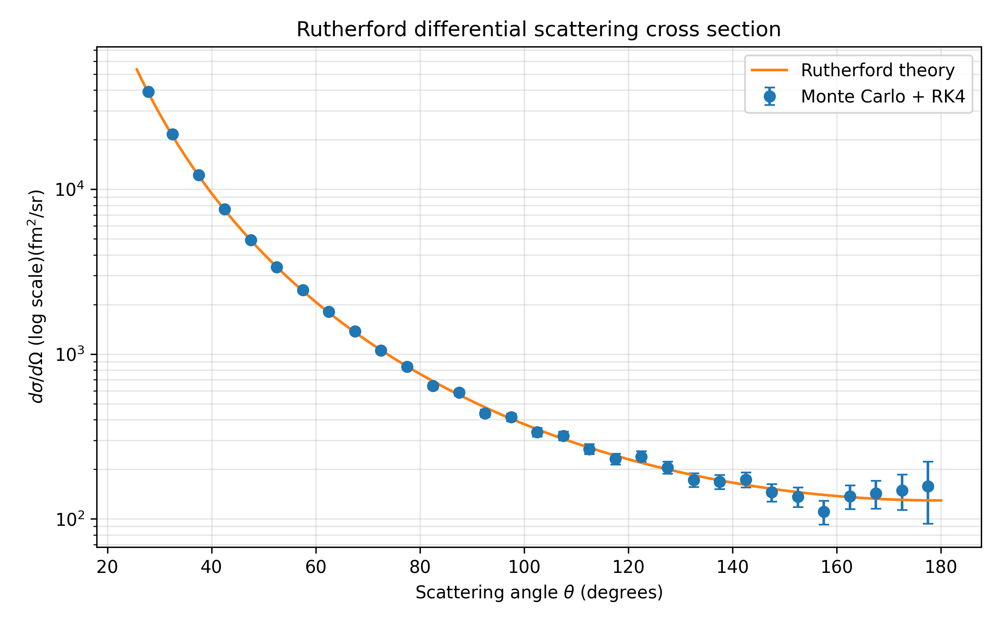
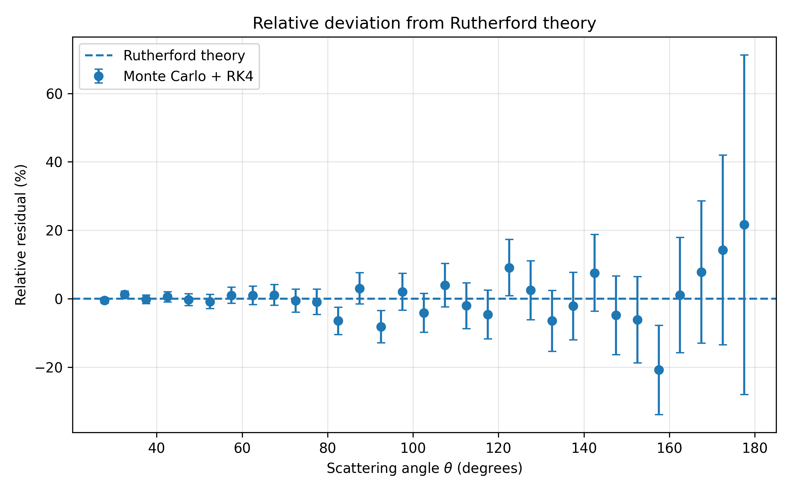

# Rutherford differential cross section validation

This stage extends the Monte Carlo simulation from individual scattering-angle validation to a direct numerical reconstruction of the Rutherford differential scattering cross section.

The numerical trajectories are still calculated using the previously validated RK4 integrator. The impact parameters are sampled uniformly in transverse area as described in the previous Monte Carlo stage.

The new goal is to test whether the complete numerical simulation reproduces the Rutherford angular distribution

```math
\frac{d\sigma}{d\Omega}.
```

## Monte Carlo sample

The simulation is performed for

```math
N=50000
```

events with

```math
b_{\max}=100\ \mathrm{fm}.
```

A fixed random seed is used,

```cpp
const unsigned int seed = 7;
```

so that the Monte Carlo sample is reproducible.

For each event, the sampled impact parameter is propagated through the Coulomb field using the RK4 trajectory integrator. The numerical scattering angle is then obtained from the final particle velocity.

The resulting events are stored in

```text
data/monte_carlo_scattering50000.csv
```

and analyzed with

```text
analysis/plot_cross_section.py
```

## Minimum scattering angle

Because the Monte Carlo simulation is restricted to

```math
b\leq b_{\max},
```

the generated sample has a minimum scattering angle.

From the Rutherford relation

```math
\theta(b)
=
2\arctan
\left(
\frac{K}{2Eb}
\right),
```

the minimum angle corresponds to the maximum sampled impact parameter:

```math
\theta_{\min}
=
2\arctan
\left(
\frac{K}{2Eb_{\max}}
\right).
```

For

```math
E=5\ \mathrm{MeV},
\qquad
b_{\max}=100\ \mathrm{fm},
```

this gives approximately

```math
\theta_{\min}\approx25.6^\circ.
```

Therefore, scattering angles below this value are not represented in the Monte Carlo sample.

## Angular binning

The numerical scattering angles are divided into angular bins.

The first bin begins at the physical lower limit

```math
\theta_{\min},
```

and the remaining bin edges are separated by

```math
\Delta\theta=5^\circ.
```

For each angular bin, the number of simulated events is counted:

```math
N_j.
```

The center of each bin is used only as the angular coordinate at which the corresponding Monte Carlo result is displayed.

## Cross section represented by the Monte Carlo sample

The sampled impact parameters cover a disk of radius

```math
b_{\max}.
```

Therefore, the total geometrical cross section represented by the simulation is

```math
\sigma_{\mathrm{sample}}
=
\pi b_{\max}^2.
```

Since the sample contains `N` Monte Carlo events, each event represents the cross section

```math
\sigma_{\mathrm{event}}
=
\frac{\pi b_{\max}^2}{N}.
```

If an angular bin contains `N_j` events, the cross section associated with that bin is therefore

```math
\Delta\sigma_j
=
N_j\sigma_{\mathrm{event}}.
```

This converts the Monte Carlo event counts into a physical cross section.

## Solid angle of an angular bin

In spherical coordinates,

```math
d\Omega=\sin\theta\,d\theta\,d\phi.
```

For an azimuthally symmetric scattering process, the solid angle corresponding to an angular bin extending from $\theta_1$ to $\theta_2$ is obtained by integrating over the full azimuthal angle:

```math
\Delta\Omega
=
\int_0^{2\pi}
\int_{\theta_1}^{\theta_2}
\sin\theta\,d\theta\,d\phi.
```

First,

```math
\int_{\theta_1}^{\theta_2}
\sin\theta\,d\theta
=
[-\cos\theta]_{\theta_1}^{\theta_2}
=
\cos\theta_1-\cos\theta_2.
```

Therefore,

```math
\Delta\Omega
=
2\pi
\left(
\cos\theta_1-\cos\theta_2
\right).
```

The Monte Carlo estimate of the differential cross section in each bin is then

```math
\left(
\frac{d\sigma}{d\Omega}
\right)_{\mathrm{MC},j}
=
\frac{\Delta\sigma_j}{\Delta\Omega_j}.
```


## Statistical uncertainty

The number of Monte Carlo events in each bin is subject to counting statistics.

For a bin containing `N_j` events, the statistical uncertainty is approximated by

```math
\Delta N_j
=
\sqrt{N_j}.
```

Therefore, the uncertainty of the Monte Carlo differential cross section is

```math
\Delta
\left(
\frac{d\sigma}{d\Omega}
\right)_j
=
\frac{
\sqrt{N_j}\,
\sigma_{\mathrm{event}}
}{
\Delta\Omega_j
}.
```

These uncertainties are shown as error bars in the differential-cross-section plot.

## Rutherford differential cross section

The analytical Rutherford differential cross section is

```math
\frac{d\sigma}{d\Omega}
=
\left(
\frac{K}{4E}
\right)^2
\frac{1}{
\sin^4(\theta/2)
}.
```

The Monte Carlo result reconstructed from the numerical RK4 trajectories is plotted together with this analytical prediction.

Because the differential cross section spans several orders of magnitude over the simulated angular range, the vertical axis is shown on a logarithmic scale.

The scattering-angle axis remains linear.



## Bin-averaged Rutherford prediction

For a quantitative comparison, the analytical Rutherford prediction is averaged over exactly the same solid-angle bins as the Monte Carlo data.

The Rutherford differential cross section is

```math
\frac{d\sigma}{d\Omega}
=
\frac{A}{\sin^4(\theta/2)},
```

where

```math
A=
\left(
\frac{K}{4E}
\right)^2.
```

The cross section corresponding to one angular bin is obtained by integrating the differential cross section over its solid angle:

```math
\Delta\sigma_{\mathrm R}
=
\int_{\Delta\Omega}
\frac{d\sigma}{d\Omega}\,d\Omega.
```

Using

```math
d\Omega
=
\sin\theta\,d\theta\,d\phi,
```

and integrating over the full azimuthal angle,

```math
\Delta\sigma_{\mathrm R}
=
\int_0^{2\pi}
\int_{\theta_1}^{\theta_2}
\frac{A}{\sin^4(\theta/2)}
\sin\theta\,d\theta\,d\phi.
```

Therefore,

```math
\Delta\sigma_{\mathrm R}
=
2\pi A
\int_{\theta_1}^{\theta_2}
\frac{\sin\theta}
{\sin^4(\theta/2)}
\,d\theta.
```

The integral becomes

```math
\Delta\sigma_{\mathrm R}
=
4\pi A
\left[
\frac{1}{\sin^2(\theta_1/2)}
-
\frac{1}{\sin^2(\theta_2/2)}
\right].
```

The Rutherford prediction averaged over the same solid-angle bin as the Monte Carlo result is therefore

```math
\left\langle
\frac{d\sigma}{d\Omega}
\right\rangle_{\mathrm R}
=
\frac{\Delta\sigma_{\mathrm R}}
{\Delta\Omega}.
```

Using a bin-averaged theoretical value avoids comparing a finite-width Monte Carlo bin with the analytical function evaluated only at the center of that bin.


## Relative residuals

The agreement between the Monte Carlo simulation and Rutherford theory is quantified using the relative residual

```math
R_j
=
\frac{
\left(d\sigma/d\Omega\right)_{\mathrm{MC},j}
-
\left\langle d\sigma/d\Omega\right\rangle_{\mathrm{R},j}
}{
\left\langle d\sigma/d\Omega\right\rangle_{\mathrm{R},j}
}.
```

The residual is expressed as a percentage.

A value

```math
R_j=0
```

corresponds to exact agreement with Rutherford theory.

Positive residuals indicate that the Monte Carlo cross section is larger than the analytical prediction, while negative residuals indicate that it is smaller.

The statistical uncertainty of the relative residual is

```math
\Delta R_j
=
\frac{
\Delta(d\sigma/d\Omega)_{\mathrm{MC},j}
}{
\left\langle d\sigma/d\Omega\right\rangle_{\mathrm{R},j}
}.
```



## Chi-squared goodness-of-fit test

A chi-squared statistic is calculated to quantify the overall agreement between the Monte Carlo result and Rutherford theory.

For each non-empty angular bin,

```math
\chi^2
=
\sum_j
\left(
\frac{R_j}{\Delta R_j}
\right)^2.
```

This is equivalent to comparing the difference between the Monte Carlo and theoretical differential cross sections with the statistical uncertainty of each Monte Carlo bin.

Since no parameters are fitted to the Monte Carlo data in this comparison, the number of degrees of freedom is taken as the number of non-empty angular bins:

```math
\nu=N_{\mathrm{bins}}.
```

The reduced chi-squared is

```math
\chi^2_{\mathrm{red}}
=
\frac{\chi^2}{\nu}.
```

These quantities provide a statistical measure of how well the complete Monte Carlo + RK4 simulation reproduces the analytical Rutherford differential cross section.

## Result

The reconstructed Monte Carlo differential cross section follows the analytical Rutherford prediction over the full simulated angular range.

The agreement is particularly clear at small and intermediate scattering angles, where the Monte Carlo sample contains a large number of events and the statistical uncertainties are small.

At large scattering angles the relative residuals fluctuate more strongly and the error bars increase substantially. This is expected because large-angle scattering corresponds to small impact parameters and therefore represents a much smaller part of the sampled geometrical cross section. Consequently, fewer Monte Carlo events populate these angular bins and their counting uncertainty is larger.

Despite these larger fluctuations, the uncertainty intervals of almost all Monte Carlo points are consistent with the zero-residual line. Therefore, the observed deviations do not show a systematic departure from the Rutherford prediction.

For the 31 non-empty angular bins, the goodness-of-fit test gives

```math
\chi^2 = 16.310,
```

with

```math
\nu = 31
```

degrees of freedom, corresponding to

```math
\chi^2_{\mathrm{red}}
=
\frac{\chi^2}{\nu}
=
0.526.
```

A reduced chi-squared of order unity indicates that the deviations between the numerical result and the theoretical prediction are compatible with the statistical uncertainties. Here,

```math
\chi^2_{\mathrm{red}}<1,
```

so the observed scatter is even smaller than would be expected from the estimated statistical error bars.

Thus, within the statistical precision of the 50000-event Monte Carlo sample, no statistically significant disagreement with the Rutherford differential cross section is observed.


The Monte Carlo simulation therefore reproduces the Rutherford differential scattering cross section within the statistical uncertainty of the generated sample.