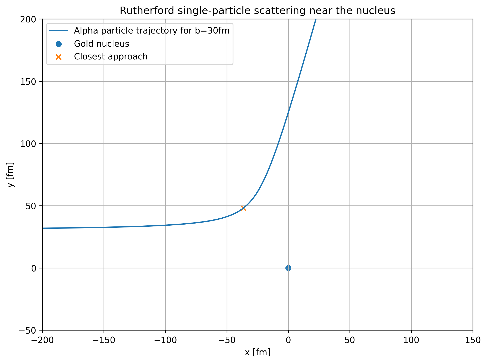

# Rutherford scattering simulation

This project numerically simulates Rutherford scattering of an alpha particle by a gold nucleus.

At this stage, the motion of a single alpha particle is calculated by numerically integrating the classical equations of motion in the repulsive Coulomb field of the nucleus. The numerical scattering angle is then compared with the analytical Rutherford result.

## Model assumptions

The simulation uses a simplified classical model of Rutherford scattering. The following assumptions are made:

- The gold nucleus is treated as a stationary point charge.
- The alpha particle is treated as a point particle.
- Only the electrostatic Coulomb interaction between the alpha particle and the gold nucleus is included.
- The recoil of the gold nucleus is neglected.
- Relativistic effects are neglected.
- The strong nuclear interaction is neglected.

Under these assumptions, the motion of the alpha particle is determined entirely by the repulsive Coulomb force produced by the gold nucleus.

## Units

The simulation uses nuclear-physics units with

```math
c=1.
```

The quantities used in the calculation are expressed in the following units:

| Quantity | Unit |
| --- | --- |
| Distance | fm |
| Time | fm/c |
| Velocity | c |
| Energy | MeV |
| Mass | MeV/c² |
| Coulomb factor | MeV·fm |

The electromagnetic coupling factor used in the simulation is

```math
\frac{e^2}{4\pi\varepsilon_0}
=
1.439964\ \mathrm{MeV\,fm}.
```

The tabulated atomic mass of a neutral helium-4 atom is approximately

```math
m_{\mathrm{He}}=4.002603\,u.
```

A neutral helium atom contains two electrons, whereas an alpha particle is the helium-4 nucleus and contains no electrons. Therefore, the atomic mass cannot be used directly as the alpha-particle mass.

The alpha-particle mass is

```math
m_\alpha \approx 4.001506\,u.
```

Using the atomic mass unit energy equivalent

```math
1\,u\,c^2 \approx 931.494\ \mathrm{MeV},
```

the alpha-particle rest energy is

```math
m_\alpha c^2
=
4.001506\,u
\cdot
931.494\ \frac{\mathrm{MeV}}{u}
\approx
3727.38\ \mathrm{MeV}.
```

Therefore, the mass value used in the simulation is

```math
m_\alpha c^2=3727.38\ \mathrm{MeV}.
```

Since the numerical calculation uses $c=1$, velocities are represented as fractions of the speed of light.


## Non-relativistic approximation

The simulation uses classical mechanics and the non-relativistic kinetic-energy expression

```math
T=\frac{1}{2}m_\alpha v^2.
```

It is therefore necessary to check that the alpha-particle velocity is small compared with the speed of light.

Introducing

```math
\beta=\frac{v}{c},
```

the kinetic energy can be written as

```math
T
=
\frac{1}{2}m_\alpha c^2\beta^2,
```


```math
\beta
=
\sqrt{
\frac{2T}{m_\alpha c^2}
}.
```

With

```math
T\approx5\ \mathrm{MeV}
```

we obtain

```math
\beta
=
\sqrt{
\frac{2\cdot5}{3727.38}
}
\approx0.0518.
```

Therefore,

```math
v\approx0.0518c,
```

which is approximately $5.2%\%$ of the speed of light.

Thus,

```math
v\ll c,
```

and the non-relativistic approximation is appropriate for this simulation.

The value $5$ MeV is used here as an approximate upper estimate of the kinetic energy. In the actual simulation, $E=5$ MeV represents the total mechanical energy, and the initial kinetic energy is slightly smaller because the particle starts at a finite distance where the Coulomb potential energy is nonzero.

## Physical model

The gold nucleus is placed at the origin,

```math
(x_{\mathrm{Au}},y_{\mathrm{Au}})=(0,0),
```

and remains stationary during the simulation.

The alpha particle approaches the nucleus from the left with impact parameter $b$:

```math
x(0)=-x_0,
\qquad
y(0)=b.
```

Its initial velocity is directed along the positive $x$-axis:

```math
\mathbf{v}(0)=(v_0,0).
```

For the current simulation,

```math
E=5\ \mathrm{MeV},
```

```math
b=30\ \mathrm{fm},
```

and

```math
x_0=10000\ \mathrm{fm}.
```

The charge numbers of the alpha particle and the gold nucleus are

```math
Z_\alpha=2,
\qquad
Z_{\mathrm{Au}}=79.
```


## Coulomb interaction

The electrostatic potential energy of the alpha particle–nucleus system is

```math
U(r)=
\frac{Z_\alpha Z_{\mathrm{Au}}e^2}
{4\pi\varepsilon_0 r}.
```

It is convenient to define

```math
K=
\frac{Z_\alpha Z_{\mathrm{Au}}e^2}
{4\pi\varepsilon_0},
```

so that

```math
U(r)=\frac{K}{r}.
```


The force is related to the potential energy by

```math
\mathbf{F}
=
-\nabla U.
```


We have

```math
\frac{dU}{dr}
=
-\frac{K}{r^2}.
```

Therefore,

```math
\mathbf{F}
=
-\frac{dU}{dr}\hat{\mathbf r}
=
\frac{K}{r^2}\hat{\mathbf r},
```


```math
\mathbf{F}
=
\frac{K}{r^3}\mathbf r.
```

Both the alpha particle and the gold nucleus are positively charged, so $K>0$. The force therefore points away from the nucleus and the interaction is repulsive.

In Cartesian coordinates,

```math
r=\sqrt{x^2+y^2},
```

and

```math
\mathbf r=(x,y).
```

Therefore, the force components are

```math
F_x=
\frac{Kx}{r^3},
\qquad
F_y=
\frac{Ky}{r^3}.
```

Using Newton's second law,

```math
\mathbf a=
\frac{\mathbf F}{m_\alpha},
```

the acceleration components are

```math
a_x=
\frac{K}{m_\alpha}
\frac{x}{r^3},
```

```math
a_y=
\frac{K}{m_\alpha}
\frac{y}{r^3}.
```

These equations determine the alpha-particle trajectory.

## Equations of motion

The equations of motion are second-order differential equations. For numerical integration, they are written as a system of four first-order differential equations:

```math
\frac{dx}{dt}=v_x,
```

```math
\frac{dy}{dt}=v_y,
```

```math
\frac{dv_x}{dt}
=
\frac{K}{m_\alpha}
\frac{x}{r^3},
```

```math
\frac{dv_y}{dt}
=
\frac{K}{m_\alpha}
\frac{y}{r^3}.
```

The state of the particle is therefore represented by

```math
Y=
(x,y,v_x,v_y).
```

For a given state $Y$, the derivative required by the numerical integrator is

```math
\frac{dY}{dt}
=
\left(
v_x,
v_y,
a_x,
a_y
\right).
```

## Initial conditions

The analytical Rutherford scattering problem assumes that the incoming particle starts infinitely far from the nucleus. A numerical simulation cannot start at infinity, so the alpha particle is initialized at a finite distance $x_0$.

Its initial position is

```math
x=-x_0,
\qquad
y=b.
```

The initial radial distance from the gold nucleus is therefore

```math
r_0=
\sqrt{x_0^2+b^2}.
```

The total mechanical energy is specified as

```math
E=5\ \mathrm{MeV}.
```

At the initial position,

```math
E=
T_0+U(r_0),
```

where the initial kinetic energy is

```math
T_0=
\frac{1}{2}m_\alpha v_0^2
```

and the initial Coulomb potential energy is

```math
U(r_0)=\frac{K}{r_0}.
```

Thus,

```math
E=
\frac{1}{2}m_\alpha v_0^2
+
\frac{K}{r_0}.
```

Solving for the initial speed gives

```math
v_0=
\sqrt{
\frac{2}{m_\alpha}
\left(
E-\frac{K}{r_0}
\right)
}.
```

The initial velocity components are therefore

```math
v_x(0)=v_0,
\qquad
v_y(0)=0.
```

Accounting for the initial potential energy is important because $E$ represents the total mechanical energy, rather than only the kinetic energy of the incoming particle.

As $x_0$ becomes very large,

```math
\frac{K}{r_0}\rightarrow0,
```

and the initial kinetic energy approaches the specified total energy $E$.

## Numerical integration

The equations of motion are integrated using the classical fourth-order Runge-Kutta method (RK4).

For a system

```math
\frac{dY}{dt}=f(Y),
```

one integration step of size $\Delta t$ is calculated as

```math
K_1=\Delta t\,f(Y_i),
```

```math
K_2=
\Delta t\,f
\left(
Y_i+\frac{K_1}{2}
\right),
```

```math
K_3=
\Delta t\,f
\left(
Y_i+\frac{K_2}{2}
\right),
```

```math
K_4=
\Delta t\,f(Y_i+K_3).
```

The state at the next step is

```math
Y_{i+1}
=
Y_i+
\frac{K_1+2K_2+2K_3+K_4}{6}.
```

The current simulation uses

```math
\Delta t=1\ \mathrm{fm}/c.
```

At each integration step, the simulation stores the time, position, velocity, total energy, and angular momentum in `trajectory.csv`.

The integration is stopped after the alpha particle has passed the nucleus and reached approximately the same radial distance from the nucleus as at the beginning of the simulation.

The radial distance alone is not sufficient to determine whether the particle is incoming or outgoing. Therefore, the sign of

```math
\mathbf r\cdot\mathbf v
=
xv_x+yv_y
```

is checked.


The condition

```math
\mathbf r\cdot\mathbf v>0
```

means that the radial distance is increasing. The particle is therefore moving away from the nucleus.

## Conservation checks

The Coulomb interaction is conservative and the potential energy does not depend explicitly on time. Therefore, the total mechanical energy should remain constant:

```math
E=
\frac{1}{2}m_\alpha
\left(
v_x^2+v_y^2
\right)
+
\frac{K}{r}.
```

The simulation evaluates this quantity throughout the numerical trajectory.

The relative energy error is calculated as

```math
\varepsilon_E=
\frac{|E_f-E_0|}{E_0}.
```

A second conservation law follows from the fact that the Coulomb force is a central force:

```math
\mathbf F\parallel\mathbf r.
```

The torque about the nucleus is therefore

```math
\boldsymbol{\tau}
=
\mathbf r\times\mathbf F
=
0.
```

Since

```math
\frac{d\mathbf L}{dt}
=
\boldsymbol{\tau},
```

zero torque implies conservation of angular momentum.

The motion is confined to the $xy$ plane, so the angular momentum has only a $z$ component:

```math
L_z=
m_\alpha
\left(
xv_y-yv_x
\right).
```

The relative angular-momentum error is calculated as

```math
\varepsilon_L=
\frac{|L_f-L_0|}
{|L_0|}.
```

Energy and angular-momentum conservation provide independent checks of the accuracy and stability of the numerical integration.

## Scattering angle

Far from the nucleus, the Coulomb interaction becomes weak and the alpha particle approaches an approximately straight outgoing trajectory.

The initial velocity is directed along the positive $x$-axis. Therefore, the angle of the final velocity vector relative to the positive $x$ direction gives the numerical scattering angle:

```math
\theta_{\mathrm{num}}
=
\mathrm{atan2}(v_y,v_x).
```

The use of both velocity components determines the correct direction of the outgoing velocity vector.

For classical Rutherford scattering, the impact parameter $b$ and the asymptotic scattering angle $\theta$ are related by

```math
b=
\frac{K}{2E}
\cot\left(
\frac{\theta}{2}
\right),
```


which gives

```math
\theta_{\mathrm{R}}
=
2\arctan
\left(
\frac{K}{2Eb}
\right).
```

The numerical and analytical scattering angles are compared using the absolute angle difference

```math
\Delta\theta
=
\left|
\theta_{\mathrm{num}}
-
\theta_{\mathrm{R}}
\right|,
```

and the relative angle error

```math
\varepsilon_\theta
=
\frac{\Delta\theta}
{|\theta_{\mathrm{R}}|}.
```

The analytical Rutherford expression describes asymptotic motion, with the incoming and outgoing particle considered infinitely far from the scattering center.

In the numerical simulation, however, the trajectory begins and ends at a finite distance. Therefore, a small difference between the numerical angle and the asymptotic Rutherford angle is expected even when the numerical integration itself is highly accurate.

## Trajectory visualization

The trajectory stored in `trajectory.csv` is plotted in the $xy$ plane using Python and Matplotlib.

The gold nucleus is located at

```math
(0,0),
```

while the alpha particle initially approaches along the positive $x$ direction with the transverse offset

```math
y=b.
```

This offset is the impact parameter.

As the alpha particle approaches the positively charged gold nucleus, the repulsive Coulomb force changes the direction of its velocity and bends the trajectory away from the nucleus.

The radial distance from the nucleus at any point along the trajectory is

```math
r(t)=
\sqrt{
x(t)^2+y(t)^2
}.
```

The point of closest approach is found numerically by locating the minimum value of $r(t)$ in the trajectory data.

Because the initial and final distances are of order thousands of femtometres while the strongest deflection occurs much closer to the nucleus, the trajectory is also displayed using a zoomed view of the scattering region.

The Python plotting script reads the trajectory directly from the CSV output produced by the C++ simulation.

The resulting single-particle trajectory is shown below.

