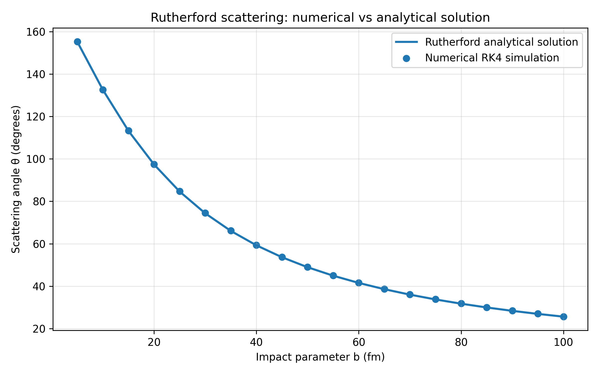
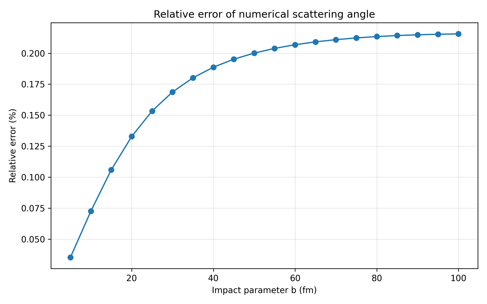

# Rutherford scattering: numerical vs analytical solution

This stage extends the single-particle Rutherford scattering simulation developed in the previous commit.

The physical model, assumptions, equations of motion, initial conditions, and fourth-order Runge-Kutta integration method are described in the README of the previous stage. Here, the simulation is extended from a single impact parameter to a range of impact parameters in order to validate the numerical model against the analytical Rutherford scattering relation.

## Extension to multiple impact parameters

In the previous stage, a single alpha-particle trajectory was simulated for a fixed impact parameter.

The simulation is now performed repeatedly for

```math
b = 5,\ 10,\ 15,\ \ldots,\ 100\ \mathrm{fm}.
```

For each value of $b$, the alpha particle starts at

```math
x=-x_0,
\qquad
y=b,
```

with

```math
x_0=10000\ \mathrm{fm}.
```

The total mechanical energy and integration step remain fixed:

```math
E=5\ \mathrm{MeV},
```

```math
\Delta t=1\ \mathrm{fm}/c.
```

The numerical integration for each impact parameter is performed independently using the same equations of motion and RK4 method as in the previous stage.

To make this possible, the single-particle calculation is now implemented as a separate function

`simulateScattering(b)`

which takes the impact parameter as input and returns the corresponding numerical scattering angle.

## Impact parameter and scattering angle

A particle with a small impact parameter passes closer to the nucleus and experiences a stronger Coulomb deflection. It therefore leaves the interaction region at a larger scattering angle.

For larger impact parameters, the particle remains farther from the nucleus, the deflection becomes weaker, and the scattering angle decreases.

Thus, the simulation should reproduce the general behavior

```math
b \uparrow
\quad\Rightarrow\quad
\theta \downarrow.
```

## Analytical Rutherford relation

For Coulomb scattering, the analytical relation between the impact parameter and the asymptotic scattering angle is

```math
b=
\frac{K}{2E}
\cot\left(
\frac{\theta}{2}
\right),
```

where

```math
K=
\frac{Z_\alpha Z_{\mathrm{Au}}e^2}
{4\pi\varepsilon_0},
```


and therefore

```math
\theta_{\mathrm{R}}(b)
=
2\arctan\left(
\frac{K}{2Eb}
\right).
```

This gives the analytical Rutherford scattering angle for every impact parameter used in the simulation.

The limiting behavior of this expression agrees with the physical interpretation of the impact parameter.

For small $b$,

```math
\frac{K}{2Eb}
```

becomes large, so the scattering angle approaches

```math
\theta \rightarrow \pi.
```

This corresponds to strong backward scattering.

For large $b$,

```math
\frac{K}{2Eb}
```

becomes small and therefore

```math
\theta \rightarrow 0.
```

The particle is then only weakly deflected.

## Numerical scattering angle

For every value of $b$, the equations of motion are integrated until the alpha particle has passed the nucleus and moved back out to approximately the initial radial distance.

The numerical scattering angle is obtained from the final velocity vector:

```math
\theta_{\mathrm{num}}
=
\mathrm{atan2}(v_y,v_x).
```

The numerical result can then be directly compared with

```math
\theta_{\mathrm{R}}(b).
```

The simulation therefore produces two scattering angles for each impact parameter:

```math
\theta_{\mathrm{num}}(b)
```

from the numerical RK4 trajectory, and

```math
\theta_{\mathrm{R}}(b)
```

from the analytical Rutherford expression.

The results are stored in

`data/scattering_angles.csv`

with the columns

`b`, `theta_numerical`, `theta_theory`, and `relative_error`.

## Relative error

For each impact parameter, the difference between the numerical and analytical results is quantified using the relative error

```math
\varepsilon_\theta
=
\frac{
\left|
\theta_{\mathrm{num}}
-
\theta_{\mathrm{R}}
\right|
}{
\left|
\theta_{\mathrm{R}}
\right|
}.
```

For visualization, the Python analysis script converts it to percent:

```math
\varepsilon_\theta(\%)
=
100\varepsilon_\theta.
```

The comparison serves as a validation of the numerical trajectory calculation. If the numerical integration reproduces Rutherford scattering, the RK4 results should follow the analytical dependence of the scattering angle on the impact parameter.

A remaining difference does not necessarily originate from the RK4 integration itself. The analytical Rutherford relation describes asymptotic scattering, where the incoming and outgoing particle are considered infinitely far from the nucleus, while the numerical trajectory starts and stops at the finite distance $x_0$.

## Numerical and analytical comparison

The script `analysis/plot_comparison.py` reads the results generated by the C++ simulation and compares the numerical scattering angles with the analytical Rutherford prediction.

The first plot shows both

```math
\theta_{\mathrm{num}}(b)
```

and

```math
\theta_{\mathrm{R}}(b)
```

as functions of the impact parameter.

The analytical solution is shown as a continuous curve, while the numerical RK4 results are shown as individual simulated points.



Agreement between the numerical points and the analytical curve shows that the numerical equations of motion reproduce the expected Rutherford dependence over the tested range of impact parameters.

## Relative error of the numerical angle

The second plot shows the relative error of the numerical scattering angle as a function of impact parameter:

```math
\varepsilon_\theta(b)
=
\frac{
\left|
\theta_{\mathrm{num}}(b)
-
\theta_{\mathrm{R}}(b)
\right|
}{
\left|
\theta_{\mathrm{R}}(b)
\right|
}.
```



This plot makes deviations that are difficult to see in the direct angle comparison more visible and provides a quantitative measure of the agreement between the numerical and analytical solutions.