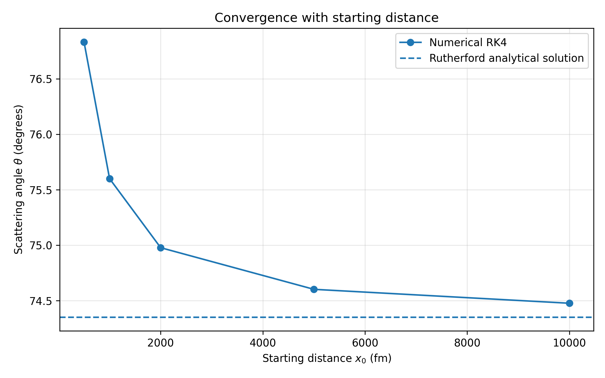
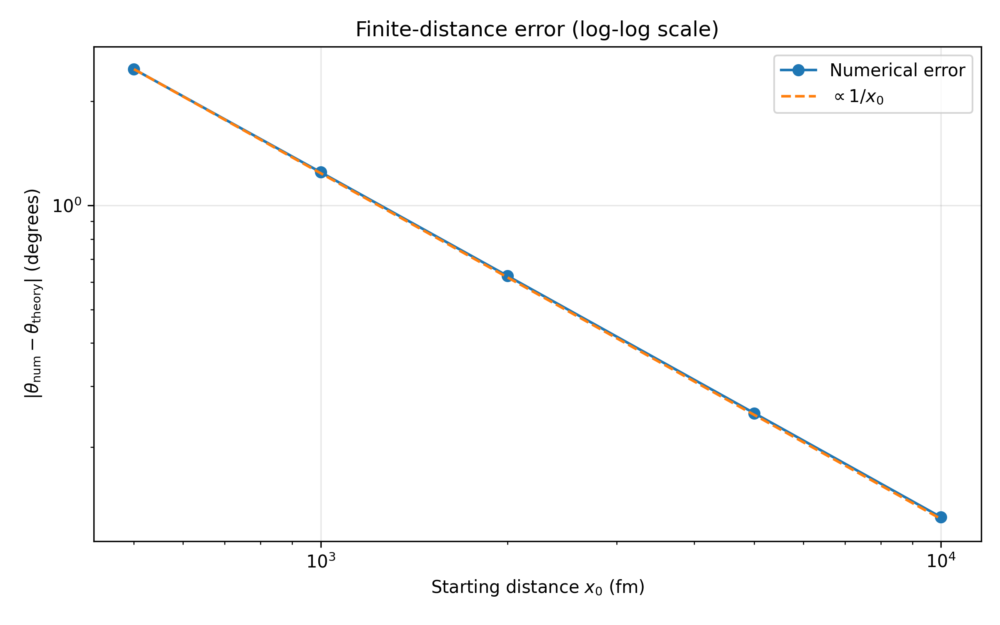

# Finite-distance and RK4 timestep convergence

In the previous stage, the Monte Carlo simulation showed a systematic difference between the numerical and analytical scattering angles:

```math
\Delta\theta
=
\theta_{\mathrm{num}}
-
\theta_{\mathrm{R}}
>0.
```

The numerical scattering angle was consistently slightly larger than the analytical Rutherford prediction. Because the difference had the same sign across the simulated events, it could not be interpreted simply as a random numerical fluctuation.

This stage investigates the origin of this discrepancy by testing two numerical parameters independently:

- the finite starting and stopping distance $x_0$;
- the RK4 integration timestep $\Delta t$.

The tests are performed for a fixed impact parameter

```math
b=30\ \mathrm{fm},
```

for which the analytical Rutherford angle is

```math
\theta_{\mathrm{R}}
=
2\arctan
\left(
\frac{K}{2Eb}
\right)
\approx
74.35198^\circ.
```

## Finite-distance convergence

The analytical Rutherford scattering angle is an asymptotic quantity. The incoming and outgoing directions correspond to the particle being infinitely far from the scattering center, where the Coulomb interaction becomes negligible.

The numerical simulation cannot start and stop at infinity. Instead, the alpha particle starts at

```math
x=-x_0,
\qquad
y=b,
```

and the integration is stopped after scattering when the particle reaches approximately the same radial distance while moving away from the nucleus.

Therefore, the numerical scattering angle is measured at a finite distance.

To determine how strongly this affects the result, the simulation is repeated for

```math
x_0=
500,\ 1000,\ 2000,\ 5000,\ 10000\ \mathrm{fm},
```

while keeping

```math
b=30\ \mathrm{fm}
```

and

```math
\Delta t=1\ \mathrm{fm}/c
```

fixed.

The absolute difference from the Rutherford result is calculated as

```math
\Delta\theta
=
\left|
\theta_{\mathrm{num}}
-
\theta_{\mathrm{R}}
\right|.
```

The results are stored in `data/finite_distance_test.csv` and analyzed by `analysis/plot_finite_distance_test.py`.

## Convergence toward the Rutherford angle

The numerical scattering angle approaches the analytical Rutherford result as the starting distance is increased.



For the tested distances, the numerical angle changes approximately as

```text
x0 =   500 fm     theta_num ≈ 76.831 deg
x0 =  1000 fm     theta_num ≈ 75.600 deg
x0 =  2000 fm     theta_num ≈ 74.978 deg
x0 =  5000 fm     theta_num ≈ 74.603 deg
x0 = 10000 fm     theta_num ≈ 74.477 deg
```

while

```math
\theta_{\mathrm{R}}
\approx
74.35198^\circ.
```

Thus,

```math
x_0\uparrow
\qquad\Longrightarrow\qquad
\theta_{\mathrm{num}}
\rightarrow
\theta_{\mathrm{R}}.
```

This demonstrates that the systematic positive difference observed in the previous stage is strongly connected to the finite distance at which the numerical trajectory is started and stopped.

At finite $x_0$, the Coulomb interaction is still nonzero. The velocity direction measured at the end of the numerical trajectory is therefore not yet exactly the asymptotic outgoing direction assumed in the Rutherford formula.


## Scaling of the finite-distance error

The decrease of the error with increasing $x_0$ shows an approximately inverse-distance dependence.

For example, doubling the starting distance approximately halves the error:

```math
x_0
\rightarrow
2x_0
```

corresponds approximately to

```math
\Delta\theta
\rightarrow
\frac{\Delta\theta}{2}.
```

Equivalently, the product

```math
x_0\Delta\theta
```

remains approximately constant over the tested range.

This suggests the empirical scaling

```math
\Delta\theta
\propto
\frac{1}{x_0}.
```

To test this behavior visually, the finite-distance error is plotted on logarithmic axes together with a reference dependence proportional to $1/x_0$.




For a general power law

```math
\Delta\theta
=
C x_0^n,
```

taking logarithms gives

```math
\log\Delta\theta
=
\log C
+
n\log x_0.
```

A power law therefore appears as a straight line on a log-log plot, with slope $n$.

For

```math
\Delta\theta
\propto
\frac{1}{x_0}
=
x_0^{-1},
```

the expected slope is

```math
n=-1.
```

## RK4 timestep convergence

A second possible source of the discrepancy is the finite RK4 integration timestep.

To test this independently, the starting distance and impact parameter are fixed at

```math
x_0=10000\ \mathrm{fm},
```

```math
b=30\ \mathrm{fm},
```

while the timestep is varied:

```math
\Delta t=
8,\ 4,\ 2,\ 1,\ 0.5\ \mathrm{fm}/c.
```

For each timestep, the trajectory is recalculated and the resulting scattering angle is compared with the same analytical Rutherford value.

The results are stored in `data/timestep_convergence_test.csv`.

The numerical scattering angle remains approximately

```math
\theta_{\mathrm{num}}
\approx
74.4774^\circ
```

over the tested timestep range.

Reducing the timestep therefore produces essentially no change in the calculated scattering angle at the precision relevant to the observed discrepancy.

In particular, the remaining difference of approximately

```math
\Delta\theta
\approx
0.125^\circ
```

at $x_0=10000$ fm does not disappear when the RK4 timestep is reduced.

This indicates that the systematic difference observed in the previous stage is not primarily caused by insufficient RK4 timestep resolution.

## Interpretation

The two convergence tests separate two different numerical effects.

The timestep test shows that the RK4 solution is already stable with respect to the integration step over the tested range:

```math
\Delta t\downarrow
\quad\not\Rightarrow\quad
\Delta\theta\rightarrow0.
```

In contrast, the finite-distance test shows clear convergence toward the analytical result:

```math
x_0\uparrow
\quad\Rightarrow\quad
\Delta\theta\downarrow.
```

Therefore, the systematic positive difference found in the previous Monte Carlo simulation is identified primarily as a finite-distance effect rather than an RK4 timestep error.