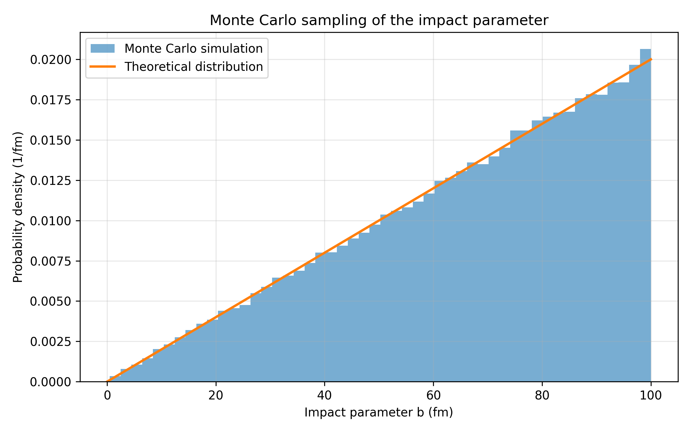

# Monte Carlo impact parameter sampling

This stage introduces Monte Carlo sampling of the impact parameter for the Rutherford scattering simulation.

The physical model, numerical trajectory integration, and validation of the numerical scattering angle against the analytical Rutherford solution were developed in the previous stages. This stage focuses only on generating and validating the distribution of impact parameters that will be used for the Monte Carlo scattering simulation.

## From a single trajectory to a particle ensemble

The previous stages considered individual alpha particles with specified impact parameters.

For a Monte Carlo simulation, the impact parameter must instead be sampled randomly for a large number of incoming particles.

The current simulation generates

```math
N=100000
```

Monte Carlo events with impact parameters in the range

```math
0\leq b\leq b_{\max},
```

where

```math
b_{\max}=100\ \mathrm{fm}.
```

Each generated value of $b$ represents the impact parameter of one incoming alpha particle.


## Geometrical distribution of the impact parameter

The incoming alpha particles are assumed to be uniformly distributed over the transverse area around the target nucleus.

The impact parameter $b$ is the perpendicular distance between the initial direction of motion of an incoming particle and the center of the nucleus.

Consider particles whose impact parameters lie between $b$ and $b+db$. Their initial trajectories pass through an annulus with radius $b$ and thickness $db$.

The area of this annulus is

```math
dA=2\pi b\,db.
```

Therefore, the number of particles with impact parameters in this interval is proportional to

```math
dN\propto2\pi b\,db.
```

This means that the impact parameter itself must not be sampled uniformly.

Larger values of $b$ correspond to larger annular areas and must therefore occur more frequently.

For a maximum impact parameter $b_{\max}$, the total sampled area is

```math
A_{\mathrm{tot}}
=
\pi b_{\max}^2.
```

The normalized probability of finding a particle between $b$ and $b+db$ is therefore

```math
dP
=
\frac{dA}{A_{\mathrm{tot}}}
=
\frac{2\pi b\,db}
{\pi b_{\max}^2}.
```

Thus,

```math
dP
=
\frac{2b}{b_{\max}^2}\,db,
```

and the probability density of the impact parameter is

```math
p(b)
=
\frac{2b}{b_{\max}^2},
\qquad
0\leq b\leq b_{\max}.
```

The distribution is normalized because

```math
\int_0^{b_{\max}}
p(b)\,db
=
\int_0^{b_{\max}}
\frac{2b}{b_{\max}^2}\,db
=
1.
```

## Sampling the distribution

The C++ random number generator produces a uniformly distributed random number

```math
U\in[0,1).
```

To transform this uniform random number into the required impact-parameter distribution, the cumulative distribution function is used.

For the probability density

```math
p(b)=\frac{2b}{b_{\max}^2},
```

the cumulative probability is

```math
P(b)
=
\int_0^b
p(b')\,db'.
```

Therefore,

```math
P(b)
=
\int_0^b
\frac{2b'}{b_{\max}^2}\,db'
=
\frac{b^2}{b_{\max}^2}.
```

Setting the cumulative probability equal to the uniform random number,

```math
U=
\frac{b^2}{b_{\max}^2},
```

and solving for $b$ gives

```math
b
=
b_{\max}\sqrt{U}.
```

This transformation is used directly in the C++ Monte Carlo loop.

Sampling $b$ uniformly would be incorrect because it would assign equal probability to equal intervals of $b$, even though the corresponding annular areas increase with radius.

## Random number generation

The C++ implementation uses the standard `<random>` library.

A Mersenne Twister generator is initialized using `std::random_device`, and

`std::uniform_real_distribution<double>(0.0, 1.0)`

is used to generate the uniform random variable $U$.

For each Monte Carlo event, the impact parameter is then calculated as

```math
b=b_{\max}\sqrt{U}.
```

The generated values are stored in

`data/monte_carlo_impact_parameters.csv`

with the columns

`event`, `U`, and `b`.

The event number identifies the Monte Carlo event, $U$ is the generated uniform random number, and $b$ is the corresponding sampled impact parameter in femtometres.

## Validation of the sampling

The script `analysis/plot_monte_carlo.py` reads the generated impact parameters and compares their numerical distribution with the theoretical probability density

```math
p(b)
=
\frac{2b}{b_{\max}^2}.
```

The Monte Carlo sample is displayed as a normalized histogram.

Using a normalized histogram is important because the theoretical function $p(b)$ is a probability density rather than a number of events per bin.

The theoretical distribution is plotted over the histogram for direct comparison.



The expected distribution increases linearly with $b$. 