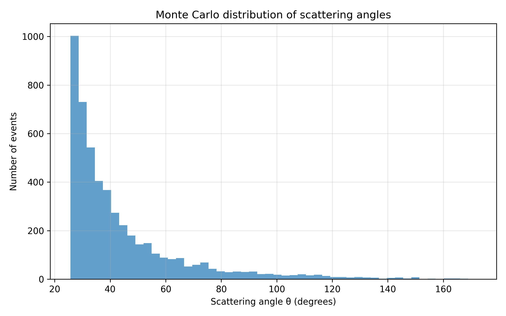
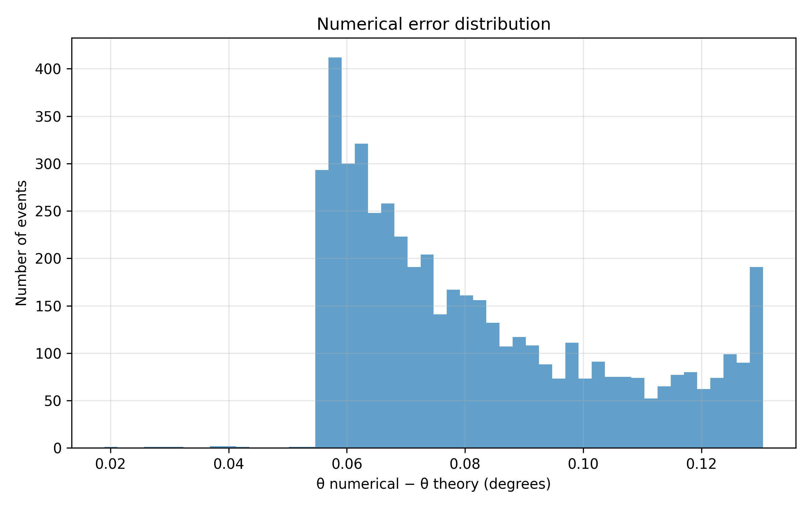

# Monte Carlo scattering simulation with RK4

This stage extends the Monte Carlo impact-parameter sampling developed in the previous stage to a full Monte Carlo simulation of Rutherford scattering.

The previous stage generated impact parameters with the geometrically correct probability density

```math
p(b)=\frac{2b}{b_{\max}^2}.
```

In this stage, each sampled impact parameter is used as the initial condition for an independent numerical scattering simulation. The trajectory of every alpha particle is integrated using the fourth-order Runge-Kutta method, and the resulting numerical scattering angle is compared with the analytical Rutherford prediction.

## Monte Carlo scattering simulation

The simulation generates

```math
N=5000
```

independent scattering events.

For each event, a uniform random number

```math
U\in[0,1)
```

is generated and transformed into an impact parameter using

```math
b=b_{\max}\sqrt{U},
```

with

```math
b_{\max}=100\ \mathrm{fm}.
```

The physical origin and validation of this sampling procedure were considered in the previous stage.

The new step introduced here is to use every sampled value of $b$ as the initial impact parameter of an alpha-particle trajectory.


## Numerical scattering angle for each event

For every sampled impact parameter $b$, the function `simulateScattering(b)` constructs the initial state of the alpha particle and numerically integrates its trajectory.

The particle starts at

```math
x=-x_0,
\qquad
y=b,
```

where

```math
x_0=10000\ \mathrm{fm}.
```

The numerical integration uses the same fourth-order Runge-Kutta method developed and validated in the previous stages, with

```math
\Delta t=1\ \mathrm{fm}/c.
```

The integration continues until the particle has passed the nucleus and reached approximately the initial radial distance while moving away from the scattering center.

The final direction of motion is determined from the final velocity components. The numerical scattering angle is therefore

```math
\theta_{\mathrm{num}}
=
\mathrm{atan2}(v_y,v_x).
```


## Analytical angle for each event

For every generated impact parameter, the analytical Rutherford scattering angle is also calculated.

The relation between impact parameter and scattering angle is

```math
b=
\frac{K}{2E}
\cot\left(\frac{\theta}{2}\right),
```

which gives

```math
\theta_{\mathrm{R}}
=
2\arctan
\left(
\frac{K}{2Eb}
\right).
```

Therefore, each Monte Carlo event produces two scattering angles:

```math
\theta_{\mathrm{num}}
```

from numerical RK4 trajectory integration, and

```math
\theta_{\mathrm{R}}
```

from the analytical Rutherford relation.

Both angles are converted from radians to degrees before being written to the output file.

## Monte Carlo output

The results of all events are stored in

`data/monte_carlo_scattering.csv`.

For every event, the file contains

`event`, `U`, `b`, `theta_numerical`, and `theta_theory`.


## Scattering-angle distribution

The script `analysis/analyze_monte_carlo_scattering.py` reads the numerical and analytical scattering angles from the Monte Carlo output.

The first histogram shows the distribution of the numerical scattering angles obtained from the RK4 trajectories.




## Numerical angle error

The second analysis compares the numerical and analytical scattering angles event by event.

For every event, the angle difference is defined as

```math
\Delta\theta
=
\theta_{\mathrm{num}}
-
\theta_{\mathrm{R}}.
```

The Python analysis constructs a histogram of these differences.



If the numerical solver reproduced the analytical Rutherford angle exactly for every event, all values would satisfy

```math
\Delta\theta=0.
```

In the numerical simulation, the values are distributed around a small nonzero difference because the numerical trajectory is calculated over a finite distance rather than from and to infinity.

The error distribution shows that

```math
\Delta\theta
=
\theta_{\mathrm{num}}
-
\theta_{\mathrm{R}}
>0.
```

Therefore, the numerical scattering angle is systematically slightly larger than the corresponding analytical Rutherford angle. This indicates a systematic difference rather than a purely random numerical fluctuation.

In the next stage, the dependence of the discrepancy on the numerical simulation parameters will be studied in order to determine its source.